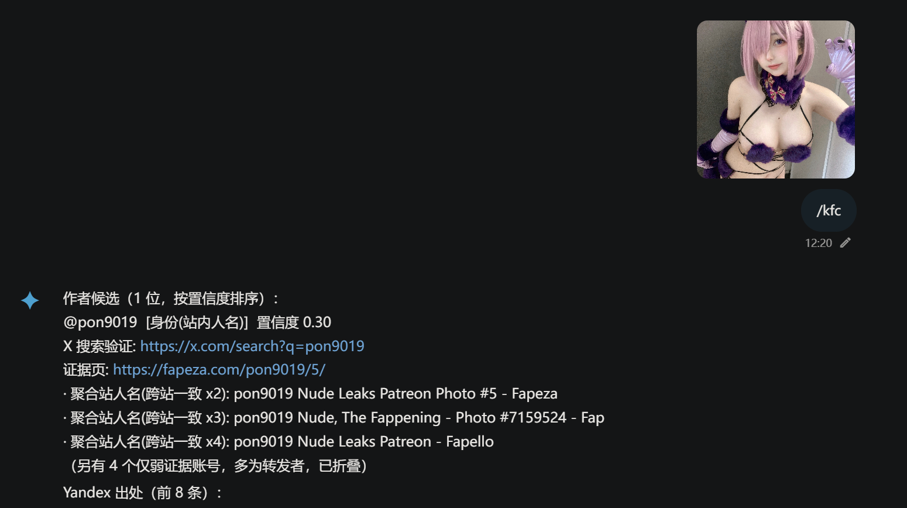

# koishi-plugin-bitchfinder

多引擎图片反向检索，定位一张图片**最可能的原始出处与作者账号**。
发送（或回复）一张图片并输入 `找鸡` / `kfc`，插件会并发调用多个反搜引擎，
按证据强度给出作者候选、原帖链接与置信度。

> **本项目移植自 [vmoranv/astrbot_plugin_bitchfinder](https://github.com/vmoranv/astrbot_plugin_bitchfinder)**
> （AstrBot 插件，作者 [vmoranv](https://github.com/vmoranv)）。
> 本仓库是该插件的 Koishi / TypeScript 移植版本，并额外注册了 ChatLuna 工具 `findbitch`。
> 原项目与本项目均以 **AGPL-3.0** 协议发布，详见 [LICENSE](./LICENSE)。

## 特性

- **多引擎并发**：Yandex、Google Lens（免 Key，开箱即用）、ASCII2D、SauceNAO、
  Google Cloud Vision、Google Lens (SerpApi)。
- **开箱即用**：不配置任何 Key 也能工作——Yandex + 免 Key Google Lens + ascii2d 默认启用；
  配置 SauceNAO / SerpApi 后可进一步提升原帖命中率。
- **证据融合而非"投票"**：正文署名、官方索引作者、标题/URL 中的账号、感知哈希同图确认分别计分，
  转发者不会被误判为原作者。
- **感知哈希硬确认**：aHash + dHash（64 位）校验候选页面中的图片是否与查询图同图，
  为跨站一致证据加权。
- **X 账号粉丝数 tie-break**：最优先两名候选置信度并列且都是 X 账号时，取粉丝数更多者
  （通过 fxTwitter 公开接口，无需 key）。
- **LLM 文字线索兜底**（可选）：无可靠署名时，让 ChatLuna 模型从来源页文字中提取账号候选；
  模型输出必须带来源原文子串，由程序逐条校验，不采信无证据的猜测。
- **不内置 LLM 配置**：模型与 API Key 完全由 `koishi-plugin-chatluna` 管理。

## 安装

```bash
npm install koishi-plugin-bitchfinder
# 或在 Koishi 控制台插件市场搜索 bitchfinder
```

若要使用 LLM 兜底或工具调用，还需安装并配置：

```bash
npm install koishi-plugin-chatluna
```

`koishi-plugin-chatluna` 是可选依赖；未安装时插件仍可正常使用 `找鸡` 命令，
只是不会注册 `findbitch` 工具、也不会进行 LLM 文字兜底。

## 使用

### 聊天命令

```
找鸡            # 附带图片发送
kfc             # 别名
```

也可以**引用（回复）一张图片**后发送命令。命令会先返回"正在多引擎检索，请稍候…"，
随后输出：

```
最优先候选：@example  [X/Twitter]
  置信度 0.80（正文署名/官方引擎/同图确认）
  原帖: https://x.com/example/status/1234567890
  · SauceNAO 索引命中: ...
  · 转发正文署名: “…credit: @example…”
```

- 只有当候选具备**正文署名、官方引擎命中或同图确认**时才作为"作者候选"展示；
  仅有标题/URL 账号的转发者会被折叠并标注低可信。
- 若所有引擎都没有署名证据，会附上 Yandex 出处列表与完整结果页，便于人工排查。

### 示例

发送一张 Coser 图片（如 `sample.png`）并输入 `找鸡`，插件会返回该图的可能出处与作者账号：

```
最优先候选：@mamamia1008  [X/Twitter]
  置信度 0.80（正文署名/官方引擎/同图确认）
  原帖: https://x.com/mamamia1008/status/...
  检索: https://x.com/search?q=from%3Amamamia1008
```




### ChatLuna 工具 `findbitch`

安装并启用 chatluna 后，插件会自动注册工具：

| 项 | 值 |
| --- | --- |
| 工具名 | `findbitch` |
| 参数 | `image_url`（可选）：图片 URL / `base64://` 数据 |
| 图片来源 | 优先 `image_url`，否则取当前消息或引用消息中的图片 |
| 返回 | 与命令相同的排序文本 |

当用户发送图片并问"这是谁 / 出自哪里 / 帮我找原图"时，模型会自行调用该工具。
**插件不包含任何模型、Provider 或 API Key 配置**——请在 chatluna 插件中配置好模型，
再到本插件配置项里选择用于 LLM 兜底的 `model` 即可。

## 配置项

### 基础设置

| 配置 | 默认值 | 说明 |
| --- | --- | --- |
| `maxResults` | `8` | 输出的候选/出处数量上限 |
| `timeout` | `20` | 单引擎请求超时（秒） |
| `proxy` | 空 | HTTP 代理，如 `http://127.0.0.1:7890`；留空直连 |
| `sendAsForward` | `true` | 以合并转发发送结果（`figure` 元素，OneBot / Red 适配器实测可用；发送失败或适配器不支持时自动回退为普通消息） |

### 搜索引擎凭据

| 配置 | 说明 |
| --- | --- |
| `saucenaoApiKey` | SauceNAO API Key（[免费申请](https://saucenao.com/user.php?page=search-api)，100 次/天）。**强烈建议配置**，对 X / Pixiv 原帖命中率提升最大 |
| `gcvApiKey` | Google Cloud Vision API Key（启用 `WEB_DETECTION`，付费） |
| `serpapiApiKey` | SerpApi Key，用于 Google Lens `exact_matches`（付费） |
| `ascii2dMode` | ascii2d 请求模式：`default` 不携带 Cookie（与 flj_finder 一致，默认）；`cookie` 携带下方 `cf_clearance` |
| `ascii2dCookie` | ascii2d 的 Cloudflare `cf_clearance` cookie，仅在 `cookie` 模式下使用 |

### 额外引擎

| 配置 | 默认值 | 说明 |
| --- | --- | --- |
| `keylessGoogleLens` | `true` | 免 Key Google Lens：直接上传图片解析 exact_matches 结果页，不依赖任何 Key |
| `serpapiVisualMatches` | `false` | Google Lens 同时查询相似图（噪声较多） |

### ChatLuna / LLM

| 配置 | 默认值 | 说明 |
| --- | --- | --- |
| `useLlmCandidates` | `true` | 无可靠署名时调用模型提取文字线索 |
| `model` | 空 | 用于文字候选解析的 ChatLuna 模型；留空则不启用 LLM 兜底 |

## 工作流程

1. **预处理**：读取 EXIF 方向；符合条件（JPEG/PNG/WebP、最长边 ≤1600px、方向正常）的图片
   保留原始字节——重新编码会改变图像内容、伤害反搜命中率；其余图片纠正方向、缩放、
   透明区填白转 JPEG、动图取第一帧。
2. **Yandex 首发**：上传图片，取得 Yandex 托管的公网原图 URL（供 SauceNAO / SerpApi Lens 使用），
   并解析相似站点列表；`.com` / `.ru` 双域名互备，验证页与"无结果"区分处理。
3. **其余引擎并发**：各引擎独立，任一失败只影响自身；失败原因会附在结果末尾，
   便于区分"确实没有署名"与"引擎被风控拦截"。免 Key Google Lens 与 ascii2d
   直接使用图片字节，**不依赖 Yandex 是否成功**。
4. **感知哈希确认**：aHash + dHash 校验候选账号页面中的图片与查询图相似度。
5. **融合评分**：
   - 正文署名（sc/credit/source/via…）：每处 +0.35
   - SauceNAO 官方索引作者：+0.45
   - Google Lens 完全匹配到 X 原帖 / 主页：+0.30 / +0.20（免 Key 与 SerpApi 同索引，按结果页去重）
   - ascii2d 结果作者：+0.30
   - 标题 / URL 中账号：+0.05 ~ +0.15（跨域名一致才提权）
   - 感知哈希同图：≥0.90 且跨 ≥2 域 +0.20；单域 +0.10；0.75–0.90 +0.05
   - 聚合站站内人名（无平台归属）置信度封顶 0.30
6. **粉丝 tie-break**：置信度并列的 X 账号取粉丝数更多者。
7. **LLM 兜底**（可选）：无强证据时让模型从来源文字中提取账号候选，逐条校验 evidence。
8. **输出**：最优先候选 + 折叠的低可信候选 + Yandex 出处列表 + 引擎状态。

## 已知限制

- 反搜引擎均依赖其网页/接口结构，**上游改版会导致解析失效**；此类问题通常表现为
  "引擎状态"中出现解析错误，而不是误报。
- 免 Key Google Lens 依赖解析 Google 结果页：部分出口 IP 会收到"需要启用 JavaScript"
  的验证页（与 flj_finder 的情况一致），此时该引擎会明确报错，而不是伪报"无结果"；
  可更换代理或配置 SerpApi 作为替代。
- ascii2d 默认按无 Cookie 方式请求，可能被 Cloudflare 拦截（默认模式下只在日志提示）；
  需要时把 `ascii2dMode` 切到 `cookie` 并填写 `cf_clearance`。
- 合并转发使用 Satori 的 `figure` 元素，目前实测在 OneBot / Red 适配器生效；其他适配器会回退为普通消息。
- 粉丝数 tie-break 只用于排序，**不作为归属证明**。
- 请自行确认使用场景合法合规；不要用本插件骚扰、定位或人肉他人。

## 开发

```bash
npm install
npm run build     # tsc → lib/
npm run dev       # tsc -w
```

目录结构：

```
src/
  index.ts        Koishi 插件入口、命令、ChatLuna 工具
  search.ts       反搜编排与输出
  engines.ts      各引擎适配
  fuse.ts         证据融合与置信度评分
  llm.ts          文字候选提取与校验
  preprocess.ts   图片预处理与感知哈希
  social.ts       fxTwitter 粉丝数查询
  http.ts         fetch + undici 代理客户端
  types.ts        通用类型
```

## 协议

[AGPL-3.0](./LICENSE)，与原项目
[vmoranv/astrbot_plugin_bitchfinder](https://github.com/vmoranv/astrbot_plugin_bitchfinder) 保持一致。

## 致谢

- 原项目：[vmoranv/astrbot_plugin_bitchfinder](https://github.com/vmoranv/astrbot_plugin_bitchfinder)
- 免 Key Google Lens 解析流程参考：[NumInvis/astrbot_plugin_flj_finder](https://github.com/NumInvis/astrbot_plugin_flj_finder)
- ChatLuna：[ChatLunaLab/chatluna](https://github.com/ChatLunaLab/chatluna)
